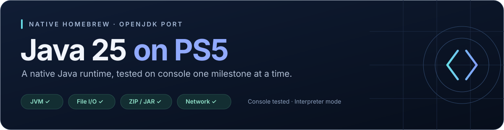

  

  <a href="#milestones">Milestones</a> ·
  <a href="#try-a-passing-build">Downloads &amp; setup</a> ·
  <a href="#where-were-going">Roadmap</a> ·
  <a href="Development/">Development</a>

# Java 25 on PS5

An experimental **native OpenJDK 25 port for PlayStation 5 homebrew**, built and tested in small, reproducible steps.

This repository contains the **Java runtime port, platform adaptations and acceptance probes**. Java 25 bytecode execution, file I/O and JAR class loading have passed their tests on a real console.

> **Current progress:** seven passing milestones on PS5 firmware **13.60**, using interpreter mode. HTTPS, IPv6 loopback, concurrent TCP traffic, IPv4 LAN TCP/UDP and forward DNS are console-tested.

**Related project:** [ps5-minecraft-java](https://github.com/mateo-cogeanu/ps5-minecraft-java) tracks Minecraft-specific work separately and will use this Java runtime.

## Milestones

Each milestone is a **frozen source snapshot** of a build that received **ALL PASS on the PS5**. Its release includes the matching app ZIP, SHA-256 checksum and console validation record.

| Milestone | Console result | Version | What passed | Download |
| :--- | :---: | :---: | :--- | :---: |
| [JVM_Startup](JVM_Startup/) | **ALL PASS** | `01.000.023` | Real VM startup, Java 25 arithmetic, Java thread start/join and VM shutdown | [Release](https://github.com/mateo-cogeanu/ps5-java25-homebrew/releases/tag/JVM_Startup-v01.000.023) |
| [IO_Probe](IO_Probe/) | **ALL PASS** | `01.000.004` | Relative paths, private-file creation, UTF-8 write/read, file size and deletion | [Release](https://github.com/mateo-cogeanu/ps5-java25-homebrew/releases/tag/IO_Probe-v01.000.004) |
| [ZIP_JAR_Probe](ZIP_JAR_Probe/) | **ALL PASS** | `01.000.000` | Stored/deflated ZIP entries, JAR manifest, JAR class loading and UTF-8 resources | [Release](https://github.com/mateo-cogeanu/ps5-java25-homebrew/releases/tag/ZIP_JAR_Probe-v01.000.000) |
| [Network_Probe](Network_Probe/) | **ALL PASS** | `01.000.003` | TCP/UDP IPv4 loopback, Java worker echo, nonblocking NIO channels and selector readiness | [Release](https://github.com/mateo-cogeanu/ps5-java25-homebrew/releases/tag/Network_Probe-v01.000.003) |
| [LAN_DNS_Probe](LAN_DNS_Probe/) | **ALL PASS** | `01.000.000` | Outbound LAN TCP/UDP echo to a Mac, forward DNS lookup and VM lifecycle | [Release](https://github.com/mateo-cogeanu/ps5-java25-homebrew/releases/tag/LAN_DNS_Probe-v01.000.000) |
| [Inbound_LAN_Probe](Inbound_LAN_Probe/) | **ALL PASS** | `01.000.000` | Inbound LAN TCP accept and UDP receive/reply with verified UTF-8 exchanges | [Release](https://github.com/mateo-cogeanu/ps5-java25-homebrew/releases/tag/Inbound_LAN_Probe-v01.000.000) |
| [Advanced_Network_Probe](Advanced_Network_Probe/) | **ALL PASS** | `01.000.002` | Verified HTTPS, IPv6 loopback, four concurrent TCP workers and repeated UDP round trips | [Release](https://github.com/mateo-cogeanu/ps5-java25-homebrew/releases/tag/Advanced_Network_Probe-v01.000.002) |
| [Development](Development/) | **In progress** | — | Current source and upcoming probes; updated as changes are completed | [Browse source](Development/) |

Passing folders stay unchanged. New work goes into `Development`; a new milestone is frozen only after its console tests pass. A successful host build alone does not qualify a milestone.

## Try a passing build

1. Choose a milestone release above and download its **app ZIP**. The latest passing probe is **Advanced_Network_Probe**; it needs Internet for HTTPS and no Mac helper.
2. Extract it and copy the **entire title folder** into the homebrew scan location used by your existing ShadowLoader setup.
3. Let the loader register the app, then launch it from the home screen.
4. Run the test rows **in order** (six for Advanced Network, five for inbound LAN and LAN/DNS, four for earlier probes). Use the **D-pad** to select and **X** to run a test. Close the app through the PS menu.

| App | Title folder |
| :--- | :--- |
| JVM startup | `PPSA99865` |
| File I/O | `PPSA99866` |
| ZIP / JAR | `PPSA99867` |
| Networking | `PPSA99868` |
| LAN / DNS | `PPSA99869` |
| Inbound LAN | `PPSA99870` |
| Advanced Network | `PPSA99871` |

The apps use separate title IDs, so you can keep the passing probes installed side by side. Keep all files inside each extracted folder, including its assets, runtime and licenses. Compare the ZIP against the checksum supplied in its release.

If a test fails, report the **app version**, **test row** and **full exception/code**. After a crash, relaunch and photograph the saved checkpoints.

## Where we're going

- [x] Start the native Java 25 VM and execute Java bytecode.
- [x] Test Java file I/O and controlled VM shutdown.
- [x] Read ZIP/JAR archives and load a Java class and resource from a JAR.
- [x] Test Java TCP/UDP loopback and NIO selector readiness.
- [x] Test outbound IPv4 LAN TCP/UDP and forward DNS resolution.
- [x] Accept inbound LAN TCP connections and receive/reply to UDP datagrams.
- [x] Verify HTTPS, IPv6 loopback and bounded concurrent/repeated TCP/UDP traffic.
- [ ] Expand TLS coverage, IPv6 LAN reachability and prolonged network workloads.
- [ ] Expand class-path/dependency loading and filesystem coverage.
- [ ] Validate JIT execution, garbage collection and sustained workloads.
- [ ] Improve JNI and native-library compatibility for Java applications.
- [ ] Test broader Java APIs, error handling and repeated application runs.

**Latest passing networking probe:** [Advanced_Network_Probe](Advanced_Network_Probe/), `PPSA99871` version `01.000.002`. Run all six rows in order. HTTPS accesses `https://example.com/` with certificate and hostname verification; IPv6 and traffic-load tests use loopback. No Mac helper is needed.

**LAN setup:** [Inbound_LAN_Probe](Inbound_LAN_Probe/) uses a Mac client helper with the PS5 address supplied at runtime. [LAN_DNS_Probe](LAN_DNS_Probe/) uses a configured Mac echo endpoint. IPv6 LAN reachability, prolonged LAN load and broader TLS configurations remain unverified.

**Current development probe:** [LAN Endurance](Development/java25/probe/lan-endurance.cpp), `PPSA99872` version `01.000.000`. The 60-second external TCP and UDP rows passed on PS5. IPv6 TCP accept timed out; IPv6 LAN remains unvalidated; shutdown also passed. The [Mac launcher](Development/tools/start_lan_endurance.command) prompts for the current PS5 IPv4 address and tries IPv6 neighbor discovery. Use [discovery only](Development/tools/check_lan_ipv6.command) to diagnose IPv6 without repeating load tests. Terminal output is saved locally and the window stays open.

## Explore the source

[Development](Development/) contains the current probe apps, Java fixtures, packaging tools and patches against a pinned FreeBSD OpenJDK source revision. The native UI grew out of a controller tester and Interface Lab prototype.

| Start here | Contents |
| :--- | :--- |
| [Port notes](Development/java25/README.md) | Build setup, platform adaptations and testing history |
| [Java fixtures](Development/java25/tests/) | The Java programs behind each acceptance test |
| [PS5 adaptations](Development/java25/patches/) | The tracked OpenJDK patch series |
| [Console results](Development/java25/console-results.json) | Recorded console evidence and version-specific results |
| [Interface Lab notes](Development/docs/interface-lab.md) | The earlier native UI prototype |

Builds currently use a macOS development environment and the community PS5 Payload SDK. Each frozen milestone's README provides its build entry point. Downloaded dependencies and generated binaries are excluded from source control; passing app packages live in Releases.

## Credits & licenses

This project builds on **OpenJDK**, the **FreeBSD OpenJDK port**, the community **PS5 Payload SDK**, and the **ps5-native-app-boilerplate**. The interface uses **Inter** typography.

Sources retain their individual licenses and upstream notices. See [THIRD_PARTY_NOTICES.md](Development/THIRD_PARTY_NOTICES.md) and [embedded runtime notices](Development/java25/EMBEDDED-RUNTIME-NOTICES.md) for attribution and licensing details.
